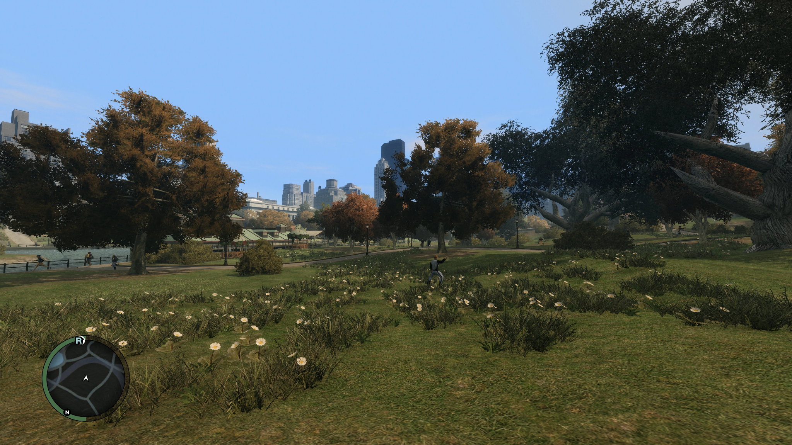
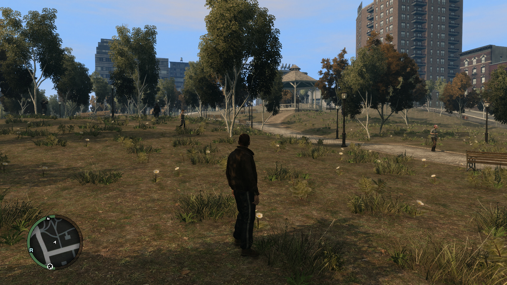
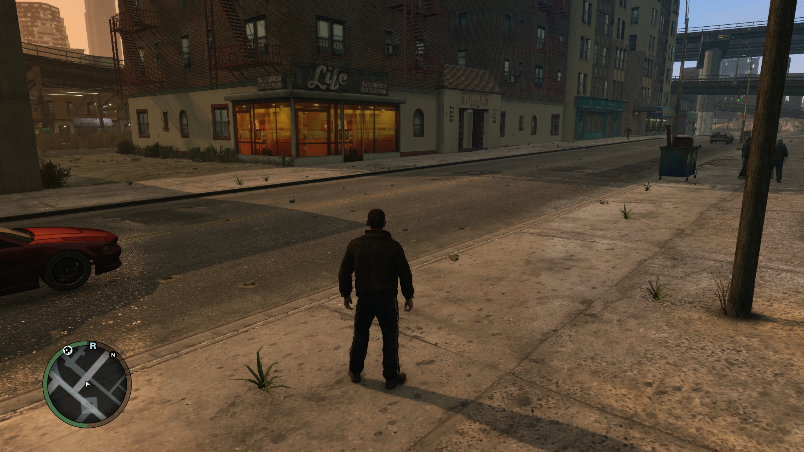
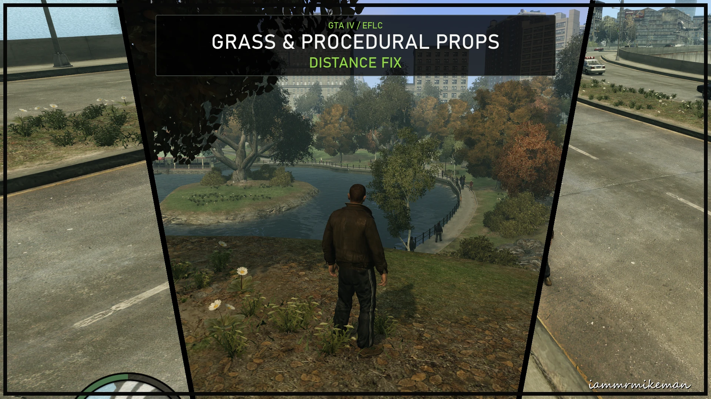
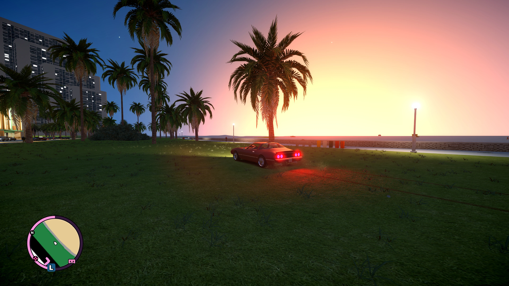
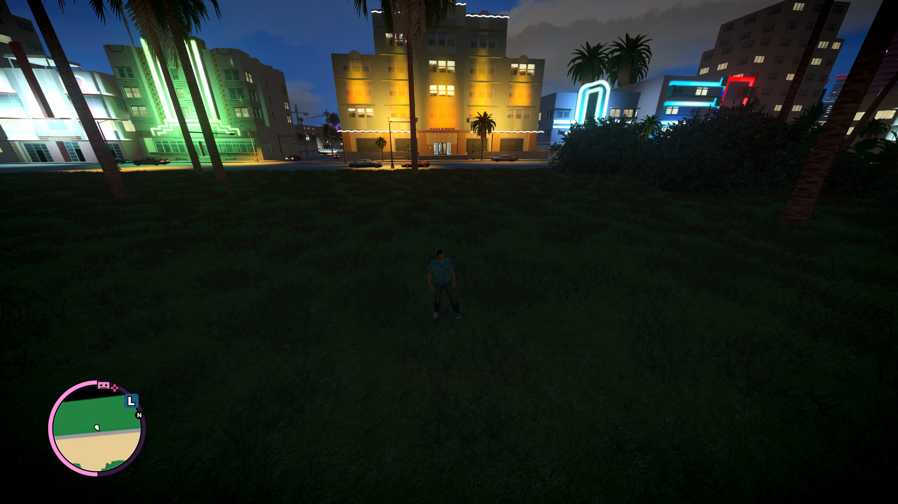

<h1 align="center">GTAIV Grass &amp; Procedural Props Fix</h1>

<p align="center">
  GTA IV normally limits how many procedural objects can exist simultaneously. Once those limits are reached, grass and other details may stop appearing, leaving large or inconsistent empty patches. This mod expands the relevant limits and offers configurable density settings.
</p>

<p align="center">
  Co-developed by <strong>iammrmikeman</strong> and <strong>mehraanakbarii</strong>.
</p>

<p align="center">
  <a href="https://www.nexusmods.com/gta4/mods/1230?tab=files">Download on Nexus Mods</a> &middot;
  <a href="https://discord.gg/4pWnszrvMP">Discord</a> &middot;
  <a href="https://github.com/iammrmikemanmods/gta-iv-grass-fix">GitHub</a>
</p>



<h2 align="center">Main features</h2>

```text
Increased maximum grass and vegetation capacity.
Increased capacity for litter, rubbish and procedural ground props.
Improved grass and vegetation coverage across Liberty City.
Configurable grass, vegetation and procedural-object density.
Adjustable procedural-object generation and visibility distance.
Individual density controls for grass, vegetation, litter and other object classes.
Rebalanced procedural and rendered-object pool capacities.
Expanded shared matrix-pool support for generated props.
Configurable generator matrix limits where applicable.
Cone-based, camera-aware procedural-prop generation.
Predictive camera-turn handling to help reduce visible prop pop-in.
Adjustable spawning radius, cone angle and prop-release limits.
Optional water-reflection control for generated procedural props.
```



<h2 align="center">Installation instructions</h2>

<p align="center">
  Install FusionFix or your preferred ASI loader.<br>
  Copy these files into your Fusion Fix GTA IV ASI plugin folder:
</p>

```text
GTAIV.EFLC.ProceduralFixes.asi
GTAIV.EFLC.ProceduralFixes.ini
```



<h2 align="center">Development Update</h2>

<p align="center">
  Originally created by <strong>iammrmikeman</strong>, Grass Fix is now officially co-developed with <strong>mehraanakbarii</strong>.<br>
  We're bringing our development work together, combining our improvements and continuing the project collaboratively.
</p>

<h3 align="center">New Features &amp; Improvements</h3>

<p align="center">
  <strong>ConeBack:</strong> Camera-aware procedural prop generation with configurable spawning and camera prediction.<br>
  <strong>Generator Improvements:</strong> Expanded matrix-pool support and additional generator controls.<br>
  <strong>Water Reflections:</strong> New optional reflection controls for procedural props.<br>
  <strong>Performance:</strong> Rebalanced object capacities and reduced background overhead.<br>
  <strong>Stability:</strong> Improved startup and failure handling, with unnecessary diagnostics removed.
</p>

<p align="center">
  <strong>Thank you</strong> to everyone supporting the project.<br>
  We look forward to continuing its development and bringing further improvements to <strong>GTA IV</strong>.
</p>

<h2 align="center">Recommended settings</h2>

```ini
[ProceduralPool]
Capacity=16384
RenderedObjectCapacity=8192
ProviderCapacity=40

DistanceMultiplier=1.25
PlantDensityMultiplier=1.0
ProceduralObjectDensityMultiplier=1.0
DensityClassMask=3

DebugLog=1
HangWatchdog=0
HangTimeoutSeconds=30
HangMessageBox=0
FullHangDump=0

GeneratorMatrixLimit=4096
GeneratorMatrixPool=0
PropsInWaterReflections=1

ConeBack=70
ConeFullAngle=75
ConeTurnLeadMs=300
```



<h2 align="center">Requirements</h2>

<p align="center">Your preferred ASI loader.</p>

<h2 align="center">Highly Recommended Mods in Screenshots</h2>

<p align="center">
  <a href="https://github.com/Tomasak/Console-Visuals/releases/">Console Vegetation</a><br>
  <a href="https://www.nexusmods.com/gta4/mods/417">Solitude 3</a>
</p>

<h2 align="center">Mod Compatibility</h2>

<p align="center">
  <strong>Props Restoration and Restored Vegetation are not recommended alongside Grass Fix v3.4</strong>, as they may cause instability or crashes.
</p>

<p align="center">
  <strong>mehraanakbarii</strong> has provided modified compatibility versions of both mods, with potentially conflicting files removed, available in <a href="https://discord.com/invite/4pWnszrvMP">Grass Fix Discord</a>.
</p>

<h3 align="center">Supported GTA IV versions</h3>

<p align="center">
  GTA IV 1.0.4.0<br>
  GTA IV 1.0.7.0<br>
  GTA IV 1.0.8.0<br>
  GTA IV Complete Edition 1.2.0.59<br>
  GTA IV Vice City Next Gen Edition
</p>



<h2 align="center">Open Source</h2>

<p align="center">
  GTAIV Grass &amp; Procedural Props Fix is now open source as of version 1.0, allowing the implementation and future development of the project to be inspected by the community.
</p>

<h2 align="center">My Mods Will Always Be Free</h2>

<p align="center">
  <a href="https://www.youtube.com/@Iammrmikeman">YouTube</a> - Please Support me<br>
  Reach me: <a href="https://www.nexusmods.com/profile/iammrmikeman">iammrmikeman25@gmail.com</a><br>
  My Discord Server - <a href="https://discord.gg/4pWnszrvMP">iammrmikeman Mods</a><br>
  Be patient — might be buried in debug log<br>
  <a href="https://github.com/iammrmikemanmods/gta-iv-grass-fix">Grass Fix GitHub</a>
</p>

<p align="center">
  Big thank you to <strong>TJDM</strong>, whose brilliant video “GTA IV Has a Grass Problem,” inspired us to create this mod.
</p>


